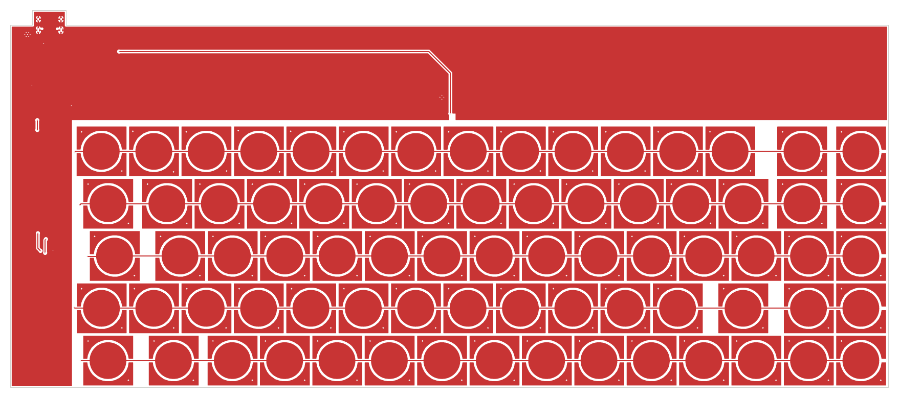
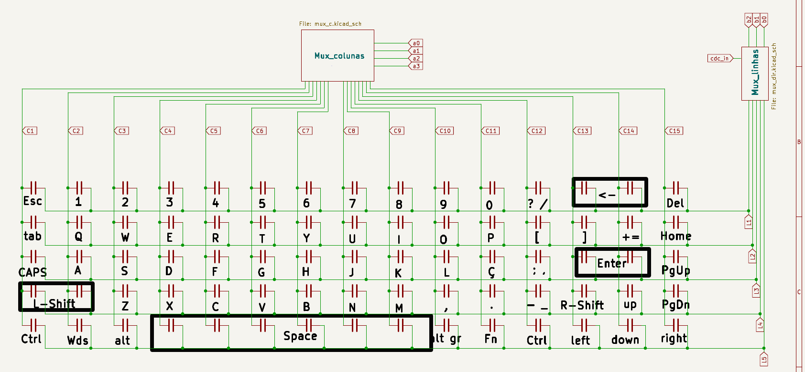
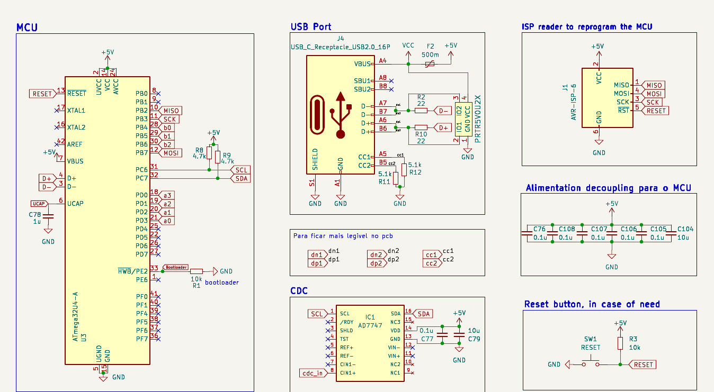
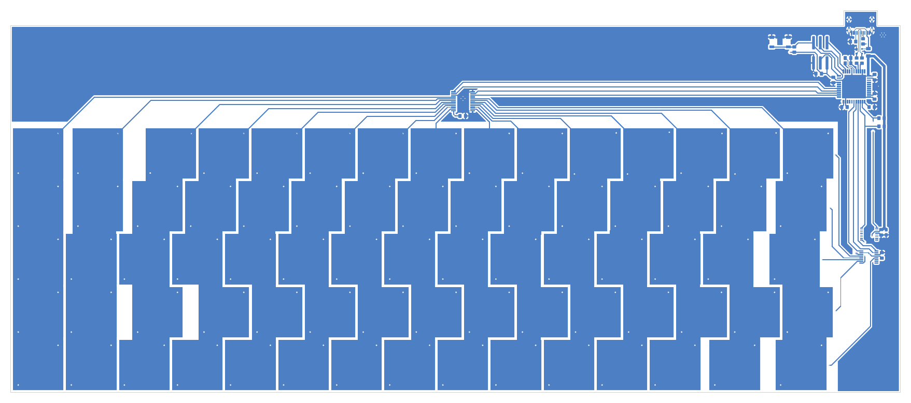

# Capacitive proximity-sensing keyboard

The hardware design, in KiCad, of a keyboard with no mechanical switches. Every
key is a capacitive sensor, so the keyboard can detect a finger as it
approaches a key and not only when the key is pressed.



## How it works

Each key is a small capacitor formed by a round pad on the top copper layer and
an electrode on the bottom layer. A finger near the pad changes that
capacitance, and measuring it tells how close the finger is.

- **Sensor design.** The sensors were designed and simulated in COMSOL. Each
  pad sits inside a guard on the top layer, which shapes the near field so
  that it reaches straight up from that pad. A finger over one key therefore
  changes only that key's capacitance and is not picked up by its neighbours.

- **Key matrix.** The keys are arranged in 5 rows and 15 columns, so the whole
  layout needs only 20 lines instead of one per key.
- **Multiplexing.** Analog multiplexers (CD74HC4067 and ADG1408) connect one
  row and one column at a time, selecting a single key.
- **Measurement.** An AD7747 capacitance-to-digital converter measures the
  selected key.
- **Controller.** An ATmega32U4 drives the multiplexers, reads the AD7747
  over I²C and talks to the computer over USB-C.



## Controller board

The controller sheet holds the ATmega32U4, the USB-C port with ESD protection
and a polyfuse, the AD7747, an ISP header to reprogram the microcontroller,
decoupling, and a reset button.



## PCB

The top layer carries the round sensing pads, one per key, each surrounded by
the guard that keeps neighbouring keys from interfering.
The bottom layer carries the second set of electrodes, one stepped strip
per column of the matrix, and the routing to the controller in the top-right corner.



## Files

```
hardware/conjunto_teclado.kicad_pro   KiCad 8 project
hardware/*.kicad_sch                  schematic (main sheet, multiplexers, controller)
hardware/conjunto_teclado.kicad_pcb   PCB layout
hardware/schematic.pdf                full schematic as a PDF
assets/                               images for this README
```

Open the `.kicad_pro` file with [KiCad](https://www.kicad.org/) 8 or later.

## Credits

Designed by Gabriel A. Pedrosa and João P. R. Ferreira, Engineering Physics,
University of Minho.
